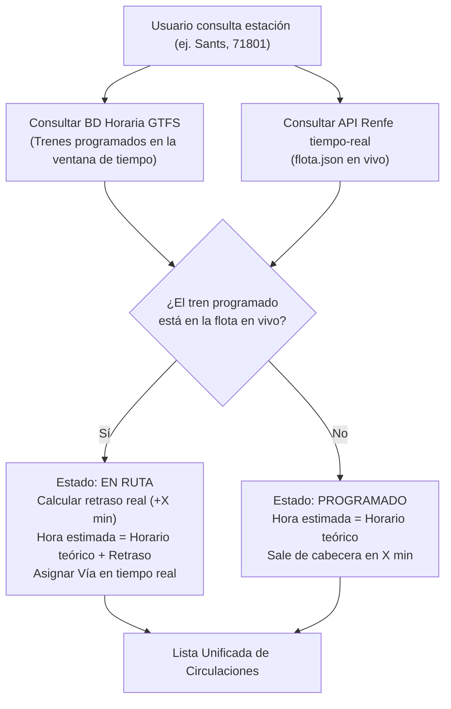

# Guía Técnica: API y Endpoints de Circulaciones de Trenes en Tiempo Real en España (Renfe / Adif)

Esta guía explica en detalle cómo funcionan las URLs y endpoints de telemetría ferroviaria en tiempo real que permiten monitorizar el tráfico de trenes de Renfe en España. Con esta información, cualquier desarrollador o analista podrá realizar consultas directas para identificar **líneas**, **estaciones**, **números de tren**, **retrasos**, **vías asignadas** y **posiciones GPS**.

---

## 1. Arquitectura y Origen de los Datos

Renfe opera dos subsistemas principales de telemetría pública en formato JSON a través de su plataforma de visor web:

1. **Cercanías y Rodalies (Toda España)**: Gestiona las circulaciones suburbanas de todos los núcleos (Madrid, Barcelona/Rodalies de Catalunya, Valencia, Sevilla, Bilbao, Asturias, etc.).
2. **Larga Distancia y Media Distancia**: Gestiona trenes de alta velocidad (AVE, Avlo), larga distancia (Alvia, Euromed, Intercity) y trenes regionales o Media Distancia (Avant, Regional Exprés, MD).

### Características Clave de los Endpoints
- **Protocolo**: HTTP/HTTPS con método `GET`.
- **Formato de datos**: JSON estándar.
- **Autenticación**: **Pública / Sin API key** (abierta para consulta directa).
- **Frecuencia de actualización**: Los servidores de Renfe refrescan la información aproximadamente cada **30 a 60 segundos**.
- **Cabeceras recomendadas**: Se aconseja enviar una cabecera `User-Agent` de navegador (por ejemplo, `User-Agent: Mozilla/5.0`) para evitar bloqueos por filtros de tráfico.

---

## 2. Los Endpoints Principales (URLs)

| Servicio | URL del Endpoint | Propósito |
| :--- | :--- | :--- |
| **Cercanías / Rodalies** | `https://tiempo-real.renfe.com/renfe-visor/flota.json` | Flota activa en vía de Cercanías de toda España con retrasos, próximas paradas y GPS. |
| **Larga / Media Distancia (Flota)** | `https://tiempo-real.largorecorrido.renfe.com/renfe-visor/flotaLD.json` | Trenes activos de LD/MD con retraso acumulado, código de producto y posición. |
| **Larga / Media Distancia (Itinerarios)** | `https://tiempo-real.largorecorrido.renfe.com/renfe-visor/trenesConEstacionesLD.json` | Horarios teóricos de paso por cada estación del recorrido y trazado geográfico. |

---

## 3. Cercanías y Rodalies: Análisis de `flota.json`

Al realizar un `GET` a `https://tiempo-real.renfe.com/renfe-visor/flota.json`, la respuesta tiene la siguiente raíz:

```json
{
  "fechaActualizacion": "2026-11-09T18:57:00",
  "trenes": [ ... ]
}
```

Cada elemento del array `trenes` representa una unidad de tren en circulación o en cabecera preparada para salir.

### Estructura de un Objeto Tren

```json
{
  "tripId": "5011D25825R1",
  "codTren": "25825",
  "codLinea": "R1",
  "nucleo": "50",
  "retrasoMin": "4",
  "codEstAct": "78805",
  "codEstSig": "71802",
  "horaLlegadaSigEst": "2026-11-09T19:08:30",
  "codEstOrig": "79600",
  "codEstDest": "72209",
  "porAvanc": "58.4",
  "latitud": 41.3871,
  "longitud": 2.1701,
  "accesible": true,
  "via": "2",
  "nextVia": "1"
}
```

### Diccionario de Campos

| Campo | Tipo | Descripción | Ejemplo |
| :--- | :--- | :--- | :--- |
| `tripId` | `string` | Identificador único del viaje (compuesto por núcleo, variante, día, tren y línea). | `"5011D25825R1"` |
| `codTren` | `string` | **Número comercial del tren** (5 dígitos). Clave para identificar el servicio. | `"25825"` |
| `codLinea` | `string` | **Línea de tren** (ej. R1, R2N, C1, C4a, C5). | `"R1"` |
| `nucleo` | `string` | **Código numérico del núcleo de Cercanías** (ver tabla de núcleos más abajo). | `"50"` (Cataluña) |
| `retrasoMin` | `string` | **Retraso en tiempo real (en minutos)**. `0` = En hora; `> 0` = Retrasado. | `"4"` |
| `codEstAct` | `string` | **Código Adif** de la última estación rebasada o donde se encuentra detenido. | `"78805"` |
| `codEstSig` | `string` | **Código Adif de la próxima estación** en la que parará o por la que pasará. | `"71802"` |
| `horaLlegadaSigEst` | `string` | Fecha y hora estimada de llegada a `codEstSig` en formato ISO 8601. | `"2026-11-09T19:08:30"` |
| `codEstOrig` | `string` | Código Adif de la estación terminal de origen. | `"79600"` (Arenys de Mar) |
| `codEstDest` | `string` | Código Adif de la estación terminal de destino final. | `"72209"` (Molins de Rei) |
| `porAvanc` | `string` | Porcentaje de avance de la ruta (`0.0` a `100.0`) o indicadores: `"E"` (En origen), `"A"` (Aproximación/Fin). | `"58.4"` o `"E"` |
| `latitud` | `float` | Latitud GPS en tiempo real de la cabeza del tren. | `41.3871` |
| `longitud` | `float` | Longitud GPS en tiempo real de la cabeza del tren. | `2.1701` |
| `accesible` | `boolean` | `true` si la unidad dispone de piso bajo adaptado a PMR (movilidad reducida). | `true` |
| `via` | `string` | Vía o andén en la que se encuentra actualmente el tren (si está en estación). | `"2"` |
| `nextVia` | `string` | **Vía o andén asignado** para la próxima parada en `codEstSig`. | `"1"` |

### Desglose Anatómico del `tripId`
El campo `tripId` condensa información vital:
```text
 50   11   D   25825   R1
 │    │    │     │      └── Código de la línea (R1)
 │    │    │     └───────── Número comercial de tren (25825)
 │    │    └─────────────── Día operativo (L, M, X, J, V, S, D)
 │    └──────────────────── Variante del servicio o turno
 └───────────────────────── Código de núcleo (50 = Rodalies Catalunya)
```

---

## 4. Códigos de Núcleo de Cercanías en España

El campo `nucleo` permite filtrar trenes por demarcación geográfica:

| Código | Núcleo de Cercanías / Rodalies | Líneas Típicas |
| :---: | :--- | :--- |
| `10` | **Madrid** | C1, C2, C3, C4a, C4b, C5, C7, C8, C9, C10 |
| `20` | **Asturias** | C1, C2, C3, C4, C5, C6, C7, C8 |
| `30` | **Sevilla** | C1, C2, C3, C4, C5 |
| `31` | **Cádiz** | C1, C1a |
| `32` | **Málaga** | C1, C2 |
| `40` | **Valencia** | C1, C2, C3, C4, C5, C6 |
| `41` | **Murcia / Alicante** | C1, C2, C3 |
| `45` / `46` / `47` | **Áreas Levantinas / Ampliaciones** | Servicios regionales suburbanos |
| `50` | **Cataluña (Rodalies de Catalunya)** | R1, R2, R2N, R2S, R3, R4, R7, R8, RG1, RL4, etc. |
| `60` | **Bilbao** | C1, C2, C3 |
| `61` | **San Sebastián / Donostia** | C1 |
| `62` | **Cantabria** | C1, C2, C3 |
| `70` | **Zaragoza** | C1 |

---

## 5. Larga Distancia y Media Distancia: `flotaLD.json` y `trenesConEstacionesLD.json`

Para trenes que no son Cercanías (AVE, Alvia, Regionales, Avant), Renfe utiliza dos archivos sincronizados:

### A) Telemetría en Vivo: `flotaLD.json`
```json
{
  "codComercial": "18014",
  "codProduct": 16,
  "ultRetraso": "12",
  "codOrigen": "11511",
  "codDestino": "10000",
  "codEstAnt": "11014",
  "codEstSig": "14100",
  "horaLlegadaSigEst": "2026-11-09T18:44:20",
  "latitud": 42.0157,
  "longitud": -4.5338,
  "mat": "449017",
  "accesible": false
}
```

* **`codComercial`**: Número de tren (equivalente a `codTren`).
* **`codProduct`**: Identifica el tipo de servicio:
  - `16`, `18`, `19`: **Media Distancia** / Regional / Regional Exprés / Avant.
  - `2`, `3`, `10`, `11`, `13`: **Larga Distancia / AVE / Alvia / Euromed / Intercity**.
* **`ultRetraso`**: Retraso en minutos medido en el último punto de control.
* **`mat`**: Identificador de la rama o locomotora del material rodante (ej. `449017` = Serie 449).

### B) Itinerario Teórico de Paradas: `trenesConEstacionesLD.json`
```json
{
  "idTren": "18014",
  "estaciones": [
    { "p": "11511", "h": "13:55", "hs": "13:55" },
    { "p": "11507", "h": "14:08", "hs": "14:09" },
    { "p": "14100", "h": "18:14", "hs": "18:18" },
    { "p": "10000", "h": "21:42", "hs": "21:42" }
  ]
}
```
* **`p`**: Código Adif de la estación.
* **`h`**: Hora teórica de llegada programada (`HH:MM`).
* **`hs`**: Hora teórica de salida programada (`HH:MM`).

---

## 6. Identificación de Estaciones (Códigos Adif de 5 Dígitos)

Toda la infraestructura ferroviaria española administrada por Adif utiliza un código unívoco de 5 caracteres numéricos.

### Principales Estaciones de Referencia en España

| Código | Estación | Provincia / Núcleo |
| :---: | :--- | :--- |
| `60000` | **Madrid - Puerta de Atocha / Atocha Cercanías** | Madrid |
| `10000` | **Madrid - Chamartín Clara Campoamor** | Madrid |
| `17000` | **Madrid - Nuevos Ministerios** | Madrid |
| `71801` | **Barcelona - Sants** | Barcelona |
| `71802` | **Barcelona - Passeig de Gràcia** | Barcelona |
| `78805` | **Barcelona - Plaça de Catalunya** | Barcelona |
| `79009` | **Barcelona - El Clot-Aragó** | Barcelona |
| `72400` | **Aeroport (El Prat T2)** | Barcelona |
| `65001` | **València Nord** | Valencia |
| `65000` | **València Joaquín Sorolla** | Valencia |
| `51003` | **Sevilla - Santa Justa** | Sevilla |
| `70100` | **Zaragoza - Delicias** | Zaragoza |
| `13200` | **Bilbao - Abando Indalecio Prieto** | Bizkaia |
| `11511` | **Donostia / San Sebastián** | Gipuzkoa |
| `15200` | **A Coruña** | A Coruña |
| `54413` | **Málaga - María Zambrano** | Málaga |

> [!TIP]
> Los catálogos completos de estaciones con su geoposición y código Adif se encuentran en el archivo local `estaciones_catalunya.json` (que alberga más de 1.100 estaciones de toda España) o en el portal de datos abiertos de Renfe (`https://data.renfe.com/`).

---

## 7. Consultas Prácticas Paso a Paso

A continuación se detallan ejemplos concretos para extraer información usando `curl` con `jq`, y scripts en Python listos para producción.

### Ejemplo 1: Consultar con `curl` y `jq`

#### A) Obtener todos los trenes con retraso en el núcleo de Madrid (`nucleo == "10"`):
```bash
curl -s -H "User-Agent: Mozilla/5.0" "https://tiempo-real.renfe.com/renfe-visor/flota.json" | \
jq '.trenes[] | select(.nucleo == "10" and (.retrasoMin | tonumber) > 0) | {tren: .codTren, linea: .codLinea, retraso: .retrasoMin, prox_estacion: .codEstSig, via: .nextVia}'
```

#### B) Buscar un tren concreto por su número (ej. Tren `25436`):
```bash
curl -s -H "User-Agent: Mozilla/5.0" "https://tiempo-real.renfe.com/renfe-visor/flota.json" | \
jq '.trenes[] | select(.codTren == "25436")'
```

#### C) Ver qué trenes se aproximan a Barcelona Sants (`71801`):
```bash
curl -s -H "User-Agent: Mozilla/5.0" "https://tiempo-real.renfe.com/renfe-visor/flota.json" | \
jq '.trenes[] | select(.codEstSig == "71801") | {linea: .codLinea, tren: .codTren, hora_estimada: .horaLlegadaSigEst, retraso: .retrasoMin, via: .nextVia}'
```

---

### Ejemplo 2: Script Completo en Python para Consultas Avanzadas

El siguiente script en Python es autónomo y permite consultar cualquier núcleo, línea, estación o número de tren en tiempo real:

```python
#!/usr/bin/env python3
"""
Monitor en tiempo real de trenes de España (Cercanías Renfe)
Uso de la API pública: https://tiempo-real.renfe.com/renfe-visor/flota.json
"""

import urllib.request
import json
from datetime import datetime

URL_FLOTA = "https://tiempo-real.renfe.com/renfe-visor/flota.json"

def obtener_flota_en_vivo():
    """Descarga el estado en tiempo real de la flota de Cercanías."""
    headers = {"User-Agent": "Mozilla/5.0 (compatible; RenfeTracker/1.0)"}
    req = urllib.request.Request(URL_FLOTA, headers=headers)
    with urllib.request.urlopen(req, timeout=10) as resp:
        return json.loads(resp.read().decode("utf-8"))

def filtrar_trenes(nucleo=None, linea=None, est_destino=None, solo_retrasados=False):
    """Filtra los trenes activos según los criterios seleccionados."""
    datos = obtener_flota_en_vivo()
    trenes = datos.get("trenes", [])
    resultados = []

    for t in trenes:
        # Filtro de núcleo (ej. "50" para Rodalies, "10" para Madrid)
        if nucleo and t.get("nucleo") != str(nucleo):
            continue

        # Filtro de línea (ej. "R1", "C5")
        if linea and t.get("codLinea", "").upper() != str(linea).upper():
            continue

        # Filtro por destino final (código Adif)
        if est_destino and t.get("codEstDest") != str(est_destino):
            continue

        # Filtro de retraso
        retraso = int(t.get("retrasoMin") or 0)
        if solo_retrasados and retraso <= 0:
            continue

        resultados.append({
            "tren": t.get("codTren"),
            "linea": t.get("codLinea"),
            "nucleo": t.get("nucleo"),
            "retraso_min": retraso,
            "origen": t.get("codEstOrig"),
            "destino": t.get("codEstDest"),
            "prox_estacion": t.get("codEstSig"),
            "llegada_prox": t.get("horaLlegadaSigEst"),
            "via_proxima": t.get("nextVia") or "Sin asignar",
            "gps": (t.get("latitud"), t.get("longitud")),
            "accesible": t.get("accesible")
        })

    return resultados

if __name__ == "__main__":
    print(f"[{datetime.now().strftime('%H:%M:%S')}] Conectando con la API de Renfe...")
    
    # Ejemplo: Buscar trenes en Cataluña (núcleo 50) de la línea R1 con retraso
    trenes_r1 = filtrar_trenes(nucleo="50", linea="R1")
    print(f"\n🚆 Trenes activos en la línea R1 de Rodalies de Catalunya ({len(trenes_r1)}):")
    for t in trenes_r1:
        estado = f"⚠️ +{t['retraso_min']} min" if t['retraso_min'] > 0 else "✅ En hora"
        print(f"• Tren {t['tren']} ({t['linea']}): {estado} | Próx. Parada: Estación {t['prox_estacion']} (Vía {t['via_proxima']}) a las {t['llegada_prox']}")
```

---

## 8. El Papel de la Programación Horaria Teórica (GTFS)

Existe un aspecto técnico esencial que debe tenerse en cuenta:

> [!IMPORTANT]
> Los endpoints en vivo (`flota.json`) **únicamente contienen trenes que están actualmente en vía** o cuyas cabinas han sido activadas por el maquinista (aproximadamente entre 5 y 15 minutos antes de la salida).
>
> Para ofrecer al usuario una vista completa de los trenes que pasarán por una estación en los próximos 60 o 90 minutos (incluyendo los que aún no han salido de la estación cabecera), es necesario combinar la telemetría en vivo con la **base de datos de horarios teóricos (GTFS)** de Renfe:

### Flujo de Consulta Combinado (Híbrido)



1. **Paso 1**: Se consulta la base de datos GTFS local (`rodalies_gtfs.db` o similar) para extraer los `trip_id` que tienen parada prevista en la estación de destino dentro del intervalo de tiempo solicitado.
2. **Paso 2**: Se descarga `flota.json` en tiempo real.
3. **Paso 3**: Se hace un cruce (_match_) por `codTren` (los 5 dígitos del número de tren):
   - Si el tren aparece en `flota.json`, se añade el valor de `retrasoMin`, la vía (`nextVia`) y las coordenadas GPS.
   - Si el tren aún no figura en `flota.json`, se muestra como "Programado" manteniendo la hora teórica prevista.

---

## 9. Buenas Prácticas y Resumen Técnico

1. **Gestión de Caché**:
   - Cachear las peticiones a `flota.json` durante **20 a 30 segundos**. Renfe no actualiza sus servidores con mayor frecuencia, por lo que llamadas más continuadas solo generarán tráfico redundante.
2. **Códigos de Estación**:
   - Utilizar siempre un catálogo normalizado de códigos Adif (5 dígitos numéricos) y un algoritmo de coincidencia de nombres (normalización de acentos y caracteres especiales) para traducir búsquedas de usuarios como "Sants", "Atocha" o "Passeig de Gràcia" a sus identificadores `71801`, `60000`, `71802`.
3. **Manejo de Tiempos**:
   - Los campos de tiempo emitidos por la API (`horaLlegadaSigEst`, `fechaActualizacion`) utilizan el huso horario oficial peninsular de España (`Europe/Madrid`).
4. **Resiliencia ante Fallos**:
   - Rodear las llamadas HTTP con un `timeout` razonable (entre 5 y 10 segundos). En situaciones de alta demanda o incidencias de red, los servidores de Renfe pueden demorarse o devolver errores transitorios 502/503.
